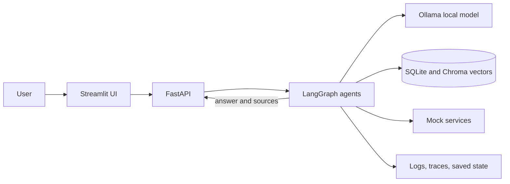
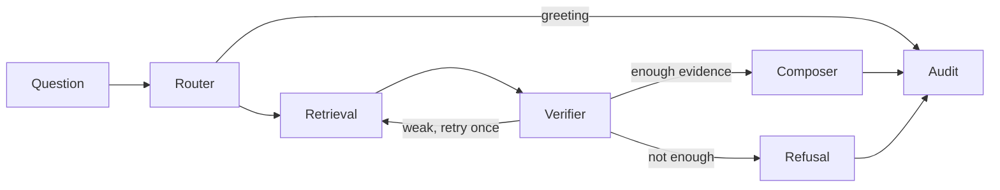

# CiteWise

> A secure, source-grounded assistant for company policies. Ask in plain words, get an answer with the document and page it came from.

    

CiteWise (the Enterprise Knowledge Intelligence Platform) helps employees find reliable answers across policy documents and SOPs. Every answer shows its source document, version and page. People only see documents their role allows, old versions are never used, and when the documents do not contain the answer, CiteWise says so instead of guessing. Admins upload and version documents, approve risky changes with a second admin, and watch a dashboard.

It is a production-style prototype that runs fully on your own machine: the language model is local (Ollama), so no company data leaves it.

## Contents

- [What it does](#what-it-does)
- [How it works](#how-it-works)
- [Quick start (local, Windows PowerShell)](#quick-start-local-windows-powershell)
- [Quick start with Docker](#quick-start-with-docker)
- [Demo accounts](#demo-accounts)
- [Using the app](#using-the-app)
- [Configuration](#configuration)
- [Scripts](#scripts)
- [Tests and evaluation](#tests-and-evaluation)
- [API overview](#api-overview)
- [Project structure](#project-structure)
- [Security and privacy](#security-and-privacy)
- [Logs, traces and saved state](#logs-traces-and-saved-state)
- [Troubleshooting](#troubleshooting)
- [Known limitations and next steps](#known-limitations-and-next-steps)

## What it does

**For employees**

- Sign in and ask questions in plain words, including follow-ups such as "and for contractors?".
- Get a short friendly answer with a comparison table when several regions or roles are involved, a "Good to know" list, follow-up suggestions, and the document, version and page behind every fact.
- Reopen saved chats, delete them, and see only the documents their role allows.

**For admins**

- Upload PDF, DOCX, TXT and CSV files with department, owner, effective date and sensitivity, as a new document or a new version.
- Duplicate detection, version history and a lifecycle: draft, active, superseded, archived, revoked.
- Request an archive or revoke; a second admin must approve it. Every step is audited and the second admin is notified.
- A dashboard with outcomes, response time (p50 and p95), tokens and cost, unanswered questions, answers marked "not helpful", ingestion problems and documents by department.

**Trust and safety**

- Role-based access is enforced inside retrieval, so a blocked document is never read for an answer.
- A verifier checks that the evidence really covers the question; otherwise the answer is an explicit "not enough evidence".
- Personal data is hidden before anything is saved, suspicious documents are quarantined, and answers are checked so they cannot cite sources that do not exist.

## How it works



Every question goes through four agents and an audit step:



| Step | Job | How it works |
|---|---|---|
| Router | Understands the question: greeting or question, department, follow-up rewrite, hides personal data | Code, plus the language model for follow-ups |
| Retrieval | Finds passages in the documents the user's role may see | Keyword search plus vector search, merged |
| Verifier | Scores whether the passages cover the question | Code |
| Composer | Writes the answer with sources, table and follow-ups, then checks it against the sources | Language model plus code checks, with a simple fallback if the model is down |
| Audit | Saves who asked and how it went | Code |

Each agent can use only its own tools, there is one bounded retry, and the graph state is saved after every step.

**Tech stack**

| Part | Technology |
|---|---|
| UI | Streamlit |
| API | FastAPI, Pydantic |
| Agents | LangGraph |
| Database | SQLite (SQLAlchemy) |
| Vector store | Chroma |
| Models | Ollama: `qwen2.5` for answers, `nomic-embed-text` for embeddings. Optional Claude fallback |
| Tracing | Optional Langfuse |
| Run | Docker Compose, or plain Python |

## Quick start (local, Windows PowerShell)

**You need:** Python 3.12 or newer, [Ollama](https://ollama.com), and Git. (macOS or Linux: use `source venv/bin/activate` and forward slashes.)

**1. Models**

```powershell
ollama pull qwen2.5:3b
ollama pull nomic-embed-text
ollama list
```

`qwen2.5:7b` gives better wording but is slower on a CPU.

**2. Get the code and install**

```powershell
git clone https://github.com/<your-username>/knowledge-platform.git
cd knowledge-platform
python -m venv venv
.\venv\Scripts\Activate.ps1
pip install -r requirements.txt
```

**3. Create the demo data**

```powershell
python scripts\generate_docs.py     # 520+ synthetic policies in data\seed (add --target 80 for a small set)
python scripts\seed_db.py           # tables, roles, demo users and documents (this wipes the database first)
python scripts\ingest.py            # chunks and vectors; takes several minutes
```

**4. Start the three services**, each in its own PowerShell window with the venv activated:

```powershell
uvicorn mock_services.main:app --port 9000      # fake HR directory and email
```

```powershell
uvicorn app.main:app --reload --port 8000       # the API
```

```powershell
streamlit run ui\app.py                         # the app
```

Open **http://localhost:8501**. The API docs are at **http://localhost:8000/docs**.

## Quick start with Docker

Docker runs the API, the mock services and the UI as containers. Ollama keeps running on your PC.

```powershell
ollama list                                                     # Ollama must be running
Copy-Item .env.example .env                                     # optional: change the model name
docker compose build
docker compose run --rm backend python scripts/generate_docs.py
docker compose run --rm backend python scripts/seed_db.py
docker compose run --rm backend python scripts/ingest.py
docker compose up
```

Open **http://localhost:8501**. The database, vectors, uploads and logs are stored in the `data` and `logs` folders on your PC. Stop with `docker compose down`.

Create the demo data inside Docker, as above, rather than copying a database made on Windows: the database stores file paths, and Windows-style paths do not work inside the Linux containers.

Run maintenance commands in the running container, for example:

```powershell
docker compose exec backend python scripts/ingest.py --missing
docker compose exec backend pytest tests -q
```

## Demo accounts

All demo passwords are `Passw0rd!`. Change them for any real use.

| Username | Role | Can do |
|---|---|---|
| `emp1` | employee | Ask questions, read Public and Internal documents |
| `hr1` | hr | Employee access, plus HR confidential documents |
| `it1` | it | Employee access, plus IT, Security and Operations confidential documents |
| `fin1` | finance | Employee access, plus Finance confidential documents |
| `legal1` | legal | Employee access, plus Legal confidential documents |
| `admin1` | admin | Everything, plus upload, approvals and the dashboard |

The approval flow needs a **second admin**. Create `admin2` once:

```powershell
python scripts\add_user.py
```

Answer the prompts: username `admin2`, name `Second Admin`, password `Passw0rd!`, role `admin`.

## Using the app

**As an employee** (`emp1`), try these in a new chat:

- How many days of annual leave do I get?
- Compare annual leave for the US and Singapore
- How do I apply for leave?
- What is the cafeteria menu on Friday? (refused: it is not in the documents)

Tick **Show sources and technical details** in the sidebar to see documents, versions, pages and how the answer was produced. Mark an answer 👍 or 👎 to give feedback.

**As an admin** (`admin1`):

1. **Manage documents > Upload**: add a new document or a new version.
2. **Manage documents > Preview and lifecycle**: choose a document, write a reason and click **Request archive** or **Request revoke**.
3. Sign out from the profile menu, sign in as `admin2`, open **Approval queue** and approve or reject. The same admin cannot approve their own request.
4. **Dashboard** shows usage, quality, documents and unanswered questions.

Approving really archives or revokes the document, so use a throwaway document when demonstrating.

## Configuration

Settings are environment variables. Running locally, set them in the PowerShell window where you start the service, for example `$env:OLLAMA_MODEL="qwen2.5:7b"`. Docker Compose reads them from `.env`. The app does not read `.env` on its own when run without Docker.

| Variable | Default | Purpose |
|---|---|---|
| `DATABASE_URL` | `sqlite:///./knowledge.db` | The SQLite database |
| `OLLAMA_URL` | `http://localhost:11434` | Where Ollama runs |
| `OLLAMA_MODEL` | `qwen2.5:3b` | Model that writes answers |
| `EMBED_MODEL` | `nomic-embed-text` | Model that creates embeddings |
| `API_URL` | `http://127.0.0.1:8000` | Where the UI finds the API |
| `MOCK_SERVICES_URL` | local port 9000 | Where the mock HR and email services run |
| `CHROMA_PATH` | `data/chroma` | Vector store folder |
| `CHECKPOINT_DB` | `data/checkpoints.sqlite` | Saved graph state |
| `LOG_FILE` / `LOG_LEVEL` | `logs/app.jsonl` / `INFO` | JSON logs |
| `ANTHROPIC_API_KEY` | not set | Optional Claude fallback when the local model fails |
| `LANGFUSE_PUBLIC_KEY`, `LANGFUSE_SECRET_KEY`, `LANGFUSE_HOST` | not set | Optional Langfuse tracing |
| `OLLAMA_PRICE_IN`, `OLLAMA_PRICE_OUT` | `0` | Optional notional price per million tokens, to show a cost figure |
| `COMPOSER_DEBUG` | not set | Set to `1` to print what reaches the answer writer |

## Scripts

| Script | What it does |
|---|---|
| `scripts\generate_docs.py` | Creates the synthetic documents, version history, edge cases and test questions in `data\seed`. Replaces the folder's old files. |
| `scripts\seed_db.py` | Creates tables, roles, demo users and loads the documents. **Drops all tables first**, including users and chats. |
| `scripts\reseed_documents.py` | Reloads only the documents tables. Keeps users and chats. Run `ingest.py` after it. |
| `scripts\ingest.py` | Builds chunks and vectors one document at a time. `--missing` finishes only documents without chunks. `--reset` wipes and rebuilds. |
| `scripts\add_user.py` | Creates a user (asks for username, name, password and role). |
| `scripts\evaluate.py` | Runs the 77-question evaluation. Add `--llm` to use the local model. |
| `scripts\show_trace.py` | Prints the saved graph state of one question step by step. |

After `generate_docs.py`, run `reseed_documents.py` and `ingest.py` so the database matches the new files.

## Tests and evaluation

```powershell
pytest tests -q
```

The tests work on a temporary copy of `knowledge.db`, so seed and ingest first. They never change your data. They cover access control, versions and approvals, retrieval and the verifier, the answer writer, saved chats, token and cost tracking, model outage and timeout, invalid input, and saved graph state without personal data.

```powershell
python scripts\evaluate.py              # fast: no language model, checks retrieval and rules
python scripts\evaluate.py --llm        # full: the local model writes every answer (slow)
```

Results are saved in `data\evaluation_summary_*.txt` and `data\evaluation_results_*.csv`. The evaluation runs on a copy of the database.

**Results from a full run with the local model on a CPU (77 questions)**

| Check | Result |
|---|---|
| Access leaks | 0 |
| Old (superseded) versions cited | 0 |
| Answerable questions with the right source | 20 of 20 |
| Restricted, old-version, out-of-scope and injection questions handled correctly | 33 of 33 |
| Golden (paraphrased) questions | 19 of 24 (the other 5 were refused rather than guessed) |
| Errors | 0% |
| Response time | median about 20 s, p95 about 49 s |
| Tokens | about 843 per question, no cost for a local model |

## API overview

Interactive docs: **http://localhost:8000/docs**. Sign in to get a token and send it in the `X-Token` header.

| Endpoint | Purpose |
|---|---|
| `POST /login`, `POST /logout`, `POST /change-password` | Sign in and out, change password |
| `GET /documents` | Documents the user's role may search |
| `POST /ask` | Ask a question (optional `conversation_id`) |
| `GET /conversations`, `GET`/`DELETE /conversations/{id}` | Saved chats (owner only) |
| `POST /feedback` | Rate an answer |
| `POST /admin/upload` | Upload a document or a new version |
| `GET /admin/all-documents`, `GET /admin/documents/{id}/preview` | Document list and preview |
| `POST /admin/documents/{id}/request` | Request archive or revoke |
| `GET /admin/approvals`, `POST /admin/approvals/{id}/decide` | Approval queue and decision |
| `GET /admin/dashboard`, `/admin/unanswered`, `/admin/run/{id}`, `/admin/notifications` | Monitoring |

Example from PowerShell:

```powershell
$login = Invoke-RestMethod -Method Post -Uri http://127.0.0.1:8000/login -ContentType "application/json" -Body '{"username":"emp1","password":"Passw0rd!"}'
Invoke-RestMethod -Method Post -Uri http://127.0.0.1:8000/ask -Headers @{"X-Token"=$login.token} -ContentType "application/json" -Body '{"question":"How many days of annual leave do I get?"}'
```

## Project structure

```
knowledge-platform/
  app/                 the backend
    main.py              FastAPI server and endpoints
    models.py, db.py     database tables and connection
    admin.py             uploads, versions, approvals
    ingest.py, chunking.py, embeddings.py, vectorstore.py
    rag.py               router, hybrid search with access control, verifier
    graph.py             LangGraph flow, tool allowlist, saved state
    composer.py          answer writer with fallback
    safety.py            redaction, injection checks, citation checks
    conversations.py     saved chats
    integrations.py      mock HR and email services
    usage.py, logging_setup.py, tracing.py
  ui/                  the Streamlit screens
    app.py, chat_view.py, documents_view.py, dashboard_view.py,
    account_view.py, brand.py
  mock_services/       fake HR directory and email (port 9000)
  scripts/             data, ingestion, evaluation and helper scripts
  tests/               automated tests
  data/                generated: seed documents, vectors, uploads, checkpoints
  logs/                generated: JSON logs
  .streamlit/          UI theme
  Dockerfile, docker-compose.yml, .env.example, requirements.txt
```

## Security and privacy

- **Access control:** each document has an access list per role. Retrieval only searches documents that are active, fully ingested, already in effect and allowed for the user's role.
- **Sign-in:** passwords are hashed, sessions expire after one hour, and five wrong passwords in five minutes lock the account for a while.
- **Personal data:** emails and similar data are hidden before a question is saved, sent to the model or written to checkpoints and traces.
- **Documents:** text that tries to give the assistant instructions is flagged during ingestion and kept out of search.
- **Answers:** a source number the model invents is rejected, and numbers must appear in the sources.
- **Chats:** only their owner can read, continue or delete them. Even an admin gets "not found".
- **Approvals and audit:** archive and revoke need a second admin. Sign-ins, approvals, changes and refusals are written to an audit trail.

The demo password and the mock services are for demonstration only.

## Logs, traces and saved state

- **JSON logs:** one line per question and per request in `logs\app.jsonl`. They hold ids and numbers, never the question text.
- **Saved state:** the graph state after every step is stored in `data\checkpoints.sqlite`. The last line of "How this answer was produced" shows the trace id. Replay it with `python scripts\show_trace.py <trace id>`, or list recent ids with `python scripts\show_trace.py`.
- **Langfuse (optional):** set the three `LANGFUSE_*` variables before starting the API to see each question as a trace.

## Troubleshooting

| Problem | Fix |
|---|---|
| The UI shows a connection error on port 8000 | The API is not running. Start it, then check `python -c "import app.main"` for import errors. |
| Every question is refused | The documents have no chunks. Run `python scripts\ingest.py --missing`, and check that Ollama is running and `nomic-embed-text` is pulled. |
| Ingestion was interrupted | Run `python scripts\ingest.py --missing`. It finishes only what is missing. |
| Model not found | `ollama pull qwen2.5:3b`, or set `OLLAMA_MODEL` to a model you have. |
| Changed `OLLAMA_MODEL` but nothing changed | Set it in the same PowerShell window where you start `uvicorn`, then restart it. |
| Port already in use | `netstat -ano \| findstr :8000`, then `taskkill /PID <number> /F`. |
| The UI looks unstyled | Run `streamlit run ui\app.py` from the project root so `.streamlit\config.toml` is found. |
| Docker: the model cannot be reached | Make sure Ollama is running on your PC. The containers reach it through `host.docker.internal`. |

## Known limitations and next steps

- SQLite on one machine; sessions and background uploads live in memory and are lost on a restart.
- The local model takes about 20 seconds per answer on a CPU.
- Some paraphrased questions are refused instead of answered (the safe failure).
- No database migrations or CI pipeline yet.
- Next: a bigger database with a worker queue, a reranker for harder questions, cloud deployment.

## Author

Built by Kavya Sri Kodumuri as a capstone project.
